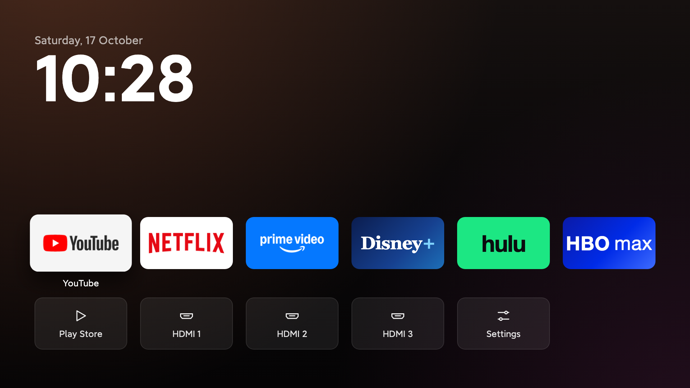

# Android TV Home

**Make an old, slow Android TV fast again, with Claude Code or Codex doing the work.**



- **Removes the junk:** bloatware, ads and sponsored rows, gone.
- **Gives you this home screen:** your apps, your HDMI inputs and a clock. Nothing else.
- **Undo anytime:** nothing is deleted for good.

## How to do it (3 steps)

### 1. Turn on developer mode on your TV

Settings → Device Preferences → About → press **Build** 7 times. Then open the new **Developer options** and turn on **USB debugging**. ([Need more help?](#turning-on-developer-mode))

### 2. Get [Claude Code](https://claude.com/claude-code) or [Codex](https://openai.com/codex) on your laptop

Your laptop and TV must be on the same Wi-Fi.

### 3. Paste this in

```
Help me clean up my Android TV and make it faster.
My TV is a <brand and model>.

1. Connect to my TV over Wi-Fi. Walk me through anything
   I need to tap on the TV.
2. Before changing anything, list every app in plain English:
   safe to turn off, needed by the TV, and apps I use.
   Check free memory.
3. Ask me before every change. Turn apps off instead of
   deleting them. Never turn off Google Play, the keyboard,
   Bluetooth or my HDMI inputs. Keep a list of what you
   changed and how to undo it.
4. Install the home screen from
   https://github.com/Ansub/android-tv-home
   with these apps: <your apps>.
5. Turn off animations and the screensaver, and make the TV
   sleep after 5 minutes.
6. Restart the TV and show me free memory before and after.
```

That's it. It does the rest and asks you before each change.

> **Disclaimer:** this is just what worked for us, not professional advice. Try it at your own risk. You're responsible for your own TV, and I'm not liable if something goes wrong.

---

## More help

### Turning on developer mode

1. On the TV, open **Settings**, then **Device Preferences** (or **System**), then **About**.
2. Press OK on **Build** 7 times until you see "You are now a developer."
3. Go back, open **Developer options** and turn on **USB debugging**. If you see **Network debugging** or **Wireless debugging**, turn that on too.
4. The first time your laptop connects, the TV asks "Allow debugging?" Tick "Always allow" and press **Allow**.

Menus differ a bit by brand. If you're stuck, ask Claude or Codex: *"I have a \<brand and model\> TV. How can you connect to it from my laptop and take control of it?"*

### The TV still opens Live TV or HDMI when it turns on

That's a TV setting, not this home screen. Ask it: *"My TV opens Live TV at startup instead of the home screen. Find that setting and turn it off."*

### Undo

Ask it to undo everything from its list, or run `sh undo.sh <TV_IP>` to remove just the home screen. If your TV's original home screen was turned off, turn it back on first.

<details>
<summary><b>For developers: build it yourself</b></summary>

1. Put your apps in `apps.txt` (package names, one per line, first six show).
2. Install Java 17 and the Android SDK. On a Mac:
   ```sh
   brew install openjdk@17
   brew install --cask android-commandlinetools
   sdkmanager "platforms;android-28" "build-tools;34.0.0"
   ```
3. Build and install: `sh install.sh <TV_IP>`

HDMI inputs are found on their own. Keep `key.jks`, which is made on your first build: updates must be signed with the same key.

It's one screen of plain Java, no libraries, no Gradle. The background is drawn once, the only animation is the focus lift, and it uses about 12 MB of RAM.

</details>

---

Made by [Ansub Khan](https://www.youtube.com/@ansubkhan). I build things like this with AI on YouTube. · MIT License
